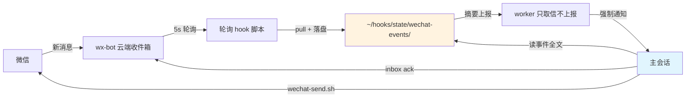

# Muse × 微信：云端接入指南（wx-bot 主会话回复方案）

**Connect Muse to WeChat with wx-bot (experimental guide).** 用 wx-bot 云端路线把微信接入 Muse，并解决默认方案对话上下文断裂的问题：事件落盘、防重发、主会话统一回复。⚠️ 实验性方案，依赖 Muse 的 hook 机制，详见下文。

本项目基于 [lawrencewzen/wx-bot](https://github.com/lawrencewzen/wx-bot)
提供的微信消息收发能力，参考其 Muse 接入文档与适配示例，整理了实验性的
"主会话回复"部署方案。具体文件来源及修改范围见
[THIRD-PARTY-NOTICES.md](THIRD-PARTY-NOTICES.md)。

> ⚠️ **实验性指南**：本仓库记录一次真实部署的试运行方案，不是稳定版软件。
> 核心链路（收发、排序、幂等、故障恢复）已通过隔离回归测试（26/26 断言），
> 但微信云端 socket 偶发断开、长周期稳定性等仍在观察中。按此部署前请读完
> `docs/tutorial.md` 的前置条件与常见问题。

## 架构流程



## 解决什么问题

按上游文档默认接法，每条微信消息唤醒的是一个**全新、无记忆**的 worker，由它组织回复。
后果：它不知道之前的对话、不知道用户的长期记忆，连续两条消息、跨渠道的事实都会断裂。

本指南的改法：**worker 只取信，不回复**——拉取消息→事件原样落盘→强制上报主会话；
**回复、确认、记忆裁决全部由主会话完成**（主会话拥有完整上下文和长期记忆）。

```
微信 → wx-bot 云端收件箱 → 轮询 hook（5s）
  → 脚本内 pull + 事件落盘 → worker 摘要上报（只上报，不回复不确认）
  → 主会话：读事件 → 组织回复 → wechat-send.sh 发送 → inbox ack
```

两种模式对比：

|  | 上游默认（worker 直接回复） | 本指南（主会话回复） |
|---|---|---|
| 回复者 | 每次全新唤醒的 worker | 主会话（完整上下文） |
| 对话连续性 | 无 | 有 |
| 长期记忆写入 | worker 越权风险 | 主会话裁决后写入 |
| 延迟 | 较低 | 较高（约 20–50 秒，见测试说明） |
| 复杂度 | 低 | 中（需状态机脚本） |

## 仓库内容

- `docs/tutorial.md` — 从零开始的完整配置教程（安装→登录→常驻→hook→验证）
- `docs/main-session-playbook.md` — 主会话操作手册：收到上报后如何接收、排序、发送、确认、处理 unknown、管理记忆
- `docs/testing.md` — 测试说明：故障注入、延迟测量、双向测试方法与验证范围
- `scripts/` — 轮询脚本、事件落盘、发送状态机、互斥锁（全部用 `$HOME`，无硬编码路径）
- `config/` — systemd 单元模板（`__HOME__`/`__USER__` 占位符）、worker prompt、重装脚本

## 快速开始

1. 先读上游文档了解 wx-bot 本体：https://github.com/lawrencewzen/wx-bot（`docs/agents/muse.md`）
2. 按 `docs/tutorial.md` 一步步部署
3. 部署后按 `docs/testing.md` 跑一遍验证

## 验证范围（诚实标注）

下表是**一次部署**（2026-10-14，单 VM、单微信号）的实测结果，不是普适保证：

| 项目 | 结果 |
|---|---|
| 故障注入 9 组 26 断言（kill -9 发送中、锁恢复、重复投递、超时识别、unknown 拦截、第三次调用、并发、锁不抢占活持有者、预写失败） | 通过（回归测试，作者与独立审阅者双环境验证） |
| 跨批按 create_time 排序 | 机制演示（Python 片段，未测真实流程） |

> 测试环境声明：回归测试在隔离 HOME 下运行（假 wx-bot 注入，未触碰真实微信），
> 环境为 Ubuntu 24.04.5 LTS、bash 5.2.21、Python 3.12.3、flock (util-linux 2.39.3)。
> 审阅者未独立运行测试，"通过"为作者实测结论。
| worker→主会话强制通知到达 | 通过（约 20 秒） |
| 真实微信往返端到端 | 51 秒（优化前）→ 22 秒（脚本内取信后） |
| 双向事实传递与更正 | 通过 |
| unknown 人工核查流程 | 未在真实环境触发 |

换环境、换网络、换平台版本，结果都可能不同。请按 `docs/testing.md` 在自己的环境重测。

## 不在仓库里的东西

出于安全，以下绝不进仓库（`.gitignore` 已排除）：`config.json`、代理 env、
登录二维码、事件文件、发送日志、记忆文件、媒体缓存。教程里涉及个人信息的
地方一律用占位符（如 `<你的wxid>`）。

## 平台依赖说明

- `scripts/wechat-inbox-watch.sh` 依赖 Muse 平台的 hook 运行时：
  脚本开头 `source "$HATCH_HOOK_RUNTIME"` 提供 `wake` / `silent` / `log`
  三个函数，`$HATCH_HOOK_DRY_RUN` 区分 dry-run。这是 Muse 内置接口，
  不是通用 shell 能力——照搬到其他平台需要自己实现等价的唤醒机制。
- worker prompt 与主会话手册依赖 Muse 的 hook worker 通知机制
  （worker 在 RESOLVE 阶段决定是否通知主会话）。
